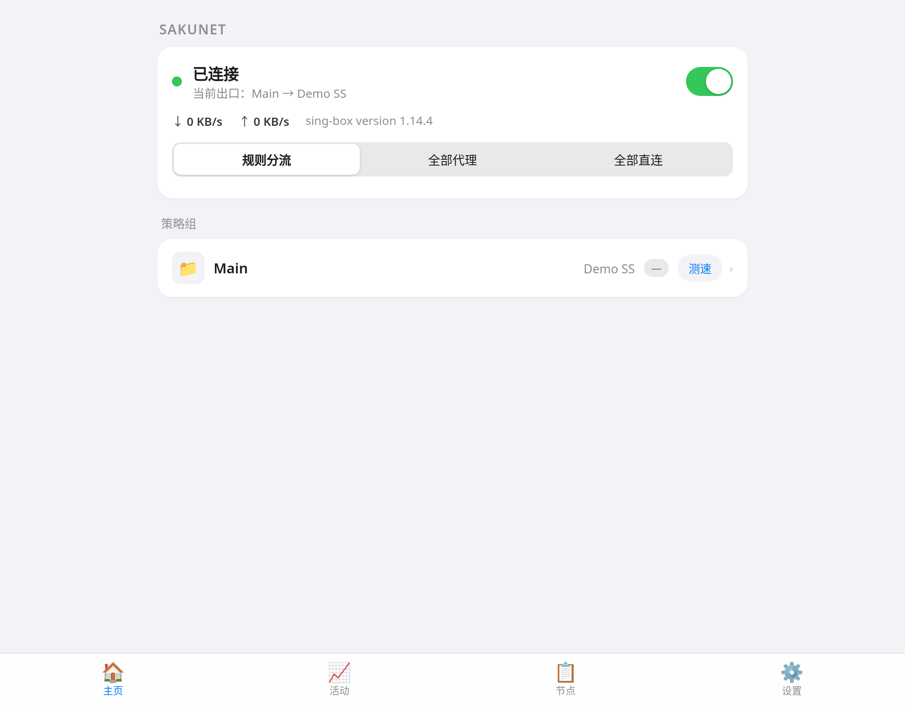
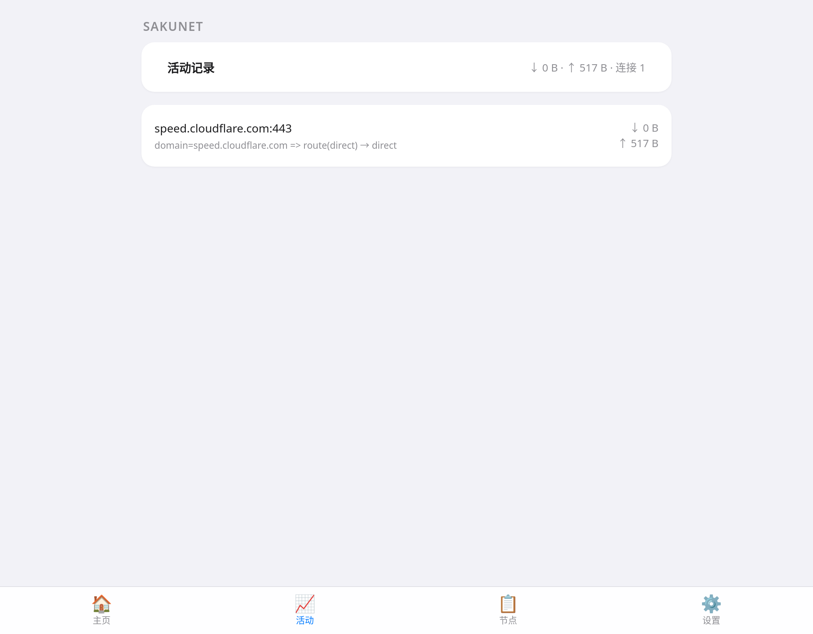
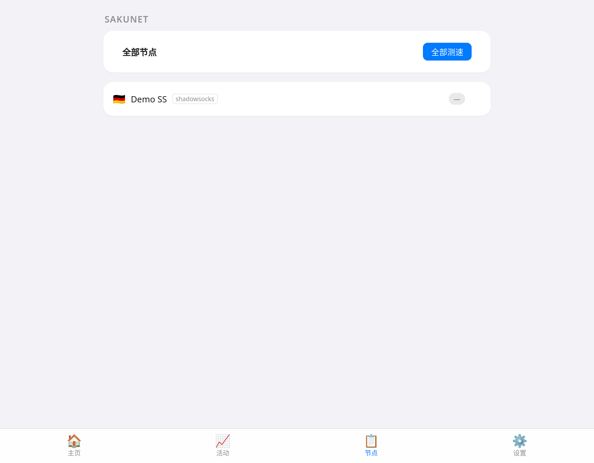
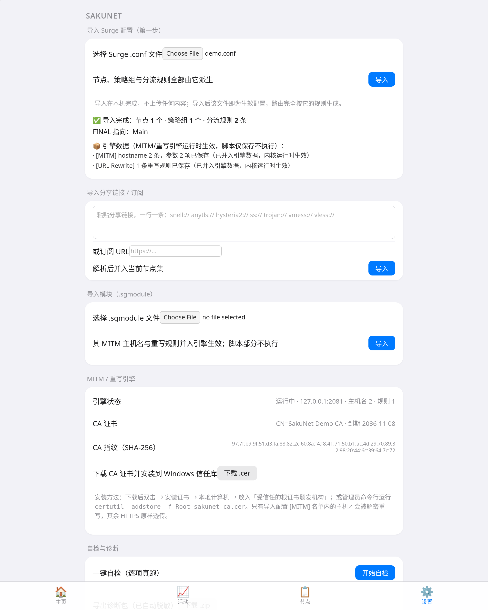

# 🌸 SakuNet

**QX 的操作与设计语言 + Surge 配置全兼容：导入一份 Surge 配置即可用。**

个人 Windows 代理客户端，不内置自己的分流体系——**Surge 配置就是配置源**：在设置页导入一份 Surge `.conf`，节点、策略组、分流规则、MITM 与 URL 重写全部由它派生，SakuNet 不叠加任何自带规则。内核选用 **sing-box ≥ 1.14**：原生覆盖 Snell 4/6（含 v6 的 `default / unshaped / unsafe-raw` 模式——这是选它的决定性理由，mihomo 正式版的 Snell 只到 v5），同时吃下 AnyTLS、Hysteria2、Naive、VLESS、VMess、Trojan、Shadowsocks，一套内核全协议。MITM/重写由自研 Go 引擎层承担（sing-box 没有这层），只解密导入配置 [MITM] 名单内的主机，其余 HTTPS 原样透传。

界面不发明新交互：**以 Quantumult X 的设计语言为第一参照**（节点行国旗＋彩色延迟胶囊、底部标签栏、卡片式策略组），操作骨架是 Surge / Shadowrocket 的范式（大开关＋「规则分流 / 全部代理 / 全部直连」三段模式＋策略组点选），换平台零学习成本。设计参数不是凭印象抄的：对 QX 1.8.1 / Surge 5.102.0 已解密 IPA 做过资源层实测提取（系统色值、36px 策略图标位、选中竖条标记等均有出处）。

## 界面



主页：状态卡（开关、三段模式、上下行速率）与策略组列表，点行即切换，延迟胶囊按系统色分档。



活动记录页：当前连接的目标主机、命中的规则、出口与流量（读内核 connections，如实呈现）。



节点页：全部节点平铺＋一键全部测速。



设置页：Surge 配置导入、分享链接/订阅导入、模块导入、MITM 引擎与 CA 状态、一键自检与诊断包导出都在这里。

## 能力矩阵（v1.1，含 JS 脚本引擎）

| 能力 | 状态 | 说明 |
|---|---|---|
| Surge [Proxy] 节点导入 | ✅ 已实现 | snell（v4/5/6，含 mode）、anytls、hysteria2、naive、ss（含 obfs 插件）、trojan、vmess、vless（含 Reality）、http/https、socks5 |
| Surge [Proxy Group] | ✅ 已实现 | select→selector；url-test/fallback→urltest；嵌套组/include/regex 筛选按语义展开 |
| 组 smart / load-balance | ⚠️ 近似 | smart→urltest（最低延迟）；load-balance→selector（sing-box 无对应物，导入报告注明） |
| Surge [Rule] | ✅ 已实现 | DOMAIN 系 / IP-CIDR / SRC-IP / DEST-PORT / PROTOCOL / PROCESS-NAME；RULE-SET 指向 surge-rules 仓时映射到 sing-box 格式 |
| 远程 RULE-SET（任意来源） | ✅ 已实现（v1.2） | URL 直供 sing-box 格式（.json/.srs）→ 远程规则集，24h 自动更新；纯文本列表（Surge/Clash 格式）→ 导入时抓取解析为内嵌集（导入时快照、重新导入刷新），拉取失败逐条报告并剔除引用规则 |
| GEOIP | ✅ 已实现（v1.2） | 映射到 SagerNet sing-geoip 远程规则集（geoip-&lt;国家码&gt;.srs，自动更新） |
| USER-AGENT、URL-REGEX、逻辑复合规则 | ❌ 不支持 | sing-box 路由层无对应物，逐条列入「未迁移清单」，不静默丢弃 |
| MITM 引擎 | ✅ 已实现 | 仅 [MITM] hostname 命中才解密；CA 用导入配置里已有的 p12（本机内存解码）；面板可下载 CA 证书并给出 Windows 安装指引 |
| URL Rewrite 引擎 | ✅ 已实现 | 302/307 重定向、reject 类（reject/reject-200/-img/-dict/-array）、header 类（请求头/响应头的 set/add/del，语法见引擎说明）；其余类型逐条标「不支持」并在设置页列出 |
| 正文重写（QX 式） | ✅ 已实现（v1.2） | `pattern request-body 搜索正则 替换` / `response-body` 同理，原生正则替换（$1 引用、替换可为空即删除）；与脚本引擎分工：简单替换走重写、复杂逻辑走脚本。边界：正文上限 4MiB（超出透传）、非 identity 编码（如 gzip）的正文不走原生重写（脚本引擎会解码处理） |
| 模块 .sgmodule | ✅ 已实现（部分） | 内嵌 MITM hostname、重写规则与脚本定义并入引擎生效（脚本见下行）；[Rule]/[Proxy] 段不并入，逐项标注 |
| Surge/QX 的 JS 脚本引擎 | ✅ 已实现（子集） | goja 运行时；`http-request` / `http-response` 脚本在 MITM 解密流量上执行（去广告主力场景）；API 子集见下文「脚本引擎子集边界」；cron/event 等其他类型保留并标注「暂不支持」 |
| 分享链接导入 | ✅ 已实现 | snell://、anytls://、hysteria2://（hy2://）、ss://（含 SIP002/老式）、trojan://、vmess://、vless:// 单链接与订阅 URL（整包 base64 自动识别） |
| TUN 模式 | ✅ 已实现 | 设置页开关；Windows 需管理员（未提权时开关直接拒绝并提示，不保存坏偏好），设置页有一键 UAC 提权重启；切换后重启失败自动回滚原设置并恢复内核运行（单测覆盖）。**验证边界**：配置生成经 sing-box check＋单测；本开发 VM 无建 TUN 接口权限（TUNSETIFF 被沙箱拒），未做接口级实测；Windows 全路由（auto_route）实测与 CI 内的 TUN 有限实测**均未做**，不宣称已验 |
| 系统托盘 | ✅ 已实现（Windows） | 开关内核、模式三段、打开面板、退出 |
| 开机自启 | ✅ 已实现（v1.2，Windows） | HKCU Run 键，设置页开关；非 Windows 构建明确不支持 |
| 订阅定时自动更新 | ✅ 已实现（v1.2） | 设置页填订阅 URL＋间隔（1–168 小时），后台定时拉取并入节点集（与手动导入同一去重合并语义，上游删掉的节点不自动 pruning）；上次更新时间与结果在设置页可见 |
| 软件自更新检查 | ✅ 已实现（v1.2） | 查 GitHub Releases，有新版在设置页提示并给下载入口；**不静默替换**，覆盖安装由用户手动完成 |
| 节点批量测速 | ✅ 已实现（v1.2 升级） | 组卡片「测速」与节点页「全部测速」走服务端并发扇出（单次请求），结果回填延迟胶囊；失败显示超时 |
| 多配置档案 | ✅ 已实现（v1.2） | 每次导入存为命名档案，设置页可切换/删除（生效中不可删）；旧版单个 imported.json 首次启动自动迁为「默认档案」 |
| 系统代理 | ✅ 已实现（Windows） | 写 HKCU 注册表；MITM 引擎运行时自动指向引擎层 |
| 活动记录 | ✅ 已实现 | 目标主机 / 规则命中 / 出口链 / 流量 / 起始时间 |
| 一键自检 | ✅ 已实现 | 内核、面板通信、DNS、经当前出口真实请求、规则集状态、MITM/CA、系统代理指向，逐项真跑、人话结论＋处置提示 |
| 导出诊断包 | ✅ 已实现 | 版本、状态、配置结构摘要、自检结果、最近日志；**导出前自动脱敏**（脱敏清单与单测在 internal/diag） |

**明确不含**：TUIC 等未建模协议的导入（内核支持、导入器未建模）、QX 的规则/脚本生态商店类功能。

### 脚本引擎子集边界（v1.1）

- **来源**：Surge 配置 [Script] 段与 .sgmodule 的 [Script] 段。`script-path` 为远程 URL 的在**导入时**下载并缓存进 `imported.json`，同时记录 SHA-256 指纹；本地路径直接读，读不到逐条在导入报告里说明（面板导入只收到配置文件本身，相对本地路径通常不可达）。引擎运行时不联网取脚本。
- **执行位置**：与 Surge 语义一致，脚本依附 MITM——只在 MITM 名单内（被解密）的请求/响应上运行；透传流量不跑脚本。gzip/deflate 响应正文会先解码再交给脚本，脚本改写后以未编码正文发出。
- **支持的 API**：`$request`、`$response`、`$done`（无参＝放行，含对 `$request`/`$response` 的原地修改；对象参数按字段改写 url/headers/body/status；请求脚本可用 `$done({response:{status,headers,body}})` 直接应答＝拒绝/模拟）、`$persistentStore`（落本机 `script-store.json`，0600）、`$notification.post`（转面板通知与引擎日志）、`console.log`（进引擎日志）、`$httpClient.get/post`（回调式，同步执行、只许 http/https、超时受脚本预算约束）。
- **QX 薄映射**：`$task.fetch`（Promise 式，映射到同一传输层）、`$prefs.valueForKey/setValueForKey/removeValueForKey`（映射到同一存储）、`$notify`（映射到通知）。
- **硬超时**：每脚本单次执行有硬超时（定义里的 `timeout` 秒数，无则默认 10 秒），到时强制中断（goja Interrupt），死循环脚本不会拖住代理；脚本报错/超时一律放行原文并记入引擎日志（设置页可查最近执行结果与日志）。
- **不支持**：`cron` / `event` / `generic` 等非 http 类型脚本（保留、标注、不执行）；`$httpAPI`（调用即抛可读错误并记日志）；`setTimeout` 等异步定时器与依赖事件循环的写法；脚本正文超过 4 MiB 的响应不进脚本（原样透传）。

## 配置来源

**主路径：Surge 配置导入**。设置页第一张卡就是导入入口，导入在本机完成、不上传任何内容。每次导入存为一份命名档案（应用目录 `profiles/`，权限 0600），生效档案同时物化为 `imported.json` 供内核生成读取；设置页可回看导入报告（成功计数＋未迁移清单＋近似说明），并在档案间切换。循环引用组、畸形行等对抗输入在解析层处理：不崩溃，逐条进报告。

**兜底（未导入任何配置时）**：手填 `nodes.json`，此时才启用内置默认五组（节点选择 / AI / 流媒体 / 社交 / 漏网之鱼）＋ surge-rules 的 merged 六件远程规则集。导入 Surge 配置后内置默认完全不生效。

## 架构

```
浏览器/系统代理/TUN
        │
┌───────▼───────────────────────────────────────┐
│ MITM/重写引擎（Go，127.0.0.1:2081，仅引擎启用时） │
│  · [MITM] 名单内 HTTPS：解密 → 重写 → 转内核    │
│  · 其余流量：CONNECT 盲隧道，原样透传            │
└───────┬───────────────────────────────────────┘
        │ CONNECT 链
┌───────▼───────────────────────────────────────┐
│ sing-box 侧车（127.0.0.1:2080 mixed / :9090 API）│
│  · 出站与路由完全由导入的 Surge 配置生成         │
└───────────────────────────────────────────────┘
SakuNet.exe（Go 外壳）：面板 127.0.0.1:18090（仅本机）、
托盘、配置生成、模式切换（应用层重生成 route＋重启内核）、自检/诊断
```

所有监听（面板 18090、mixed 2080、MITM 2081、Clash API 9090）只绑 127.0.0.1，不对外。详见 [SECURITY.md](SECURITY.md)。

## 使用

1. 从 [Releases](https://github.com/slynnnn/sakunet/releases) 下载 `SakuNet-windows-amd64.zip`，解压运行 `SakuNet.exe`（或点托盘图标打开面板），浏览器访问 http://127.0.0.1:18090 。
2. 到「设置」页导入你的 Surge `.conf`，看一眼导入报告。
3. 主页点开关启动；在设置页按需开「系统代理」或「TUN」（TUN 先点「以管理员重启」）。
4. 用了 MITM 的话，把 CA 证书装进 Windows 信任库（设置页 MITM 卡里下载 .cer，有图文步骤）。
5. **日常只需正常使用。出问题先点设置页「一键自检」；看不懂，把「诊断包」下载下来发回来即可**——包里是脱敏过的版本/配置摘要/自检结果/日志，不含节点地址与密码，你不需要描述任何技术细节。

## 验收

- 单元与实测（本机 Linux 构建全跑）：配置生成与 Snell 映射、Surge 导入（含畸形输入对抗集：截断/乱码/重复段/循环引用组不崩溃）、链接解析 7 协议、MITM 引擎真 curl 端到端（302 命中、header 改写在源站可见、非名单主机透传且证书验证走源站 CA）、诊断包脱敏断言（假凭据零出现）。
- JS 脚本引擎（v1.1）实测：单测覆盖响应 JSON 去广告字段、请求头删改、`$done` 直答拒绝、`$persistentStore` 往返、死循环脚本超时强杀后引擎存活、语法/运行错误只报错不崩；真 curl 端到端（自签 HTTPS 源站＋MITM）验证响应脚本改写正文、请求脚本注入头在源站可见、脚本 403 直答、gzip 正文解码后改写。
- sing-box check：导入配置（普通＋TUN 变体）与兜底配置均经 sing-box 1.14.4 `check` 通过。
- 监听面实查：起服后 `ss` 核对四个端口全部 127.0.0.1。
- **真 Windows 自动实测（CI）**：GitHub Actions 的 windows-latest 作业在每次发布时真跑——解压产物、启动 SakuNet.exe、导入演示配置、断言状态/分组接口与内核进程、抓面板截图存档。作业不过，版本不发。（见仓库 workflow 的 windows-smoke 作业。）
- Windows 交叉编译（CGO_ENABLED=0）＋ `go vet` 双目标（linux/windows）通过。

## 构建

```powershell
.\fetch-core.ps1                 # 下载 sing-box 1.14.4 + libcronet.dll
go build -o SakuNet.exe .        # 需要 Go 1.25+，CGO_ENABLED=0 纯静态
go test ./...
.\SakuNet.exe genconfig nodes.json out.json    # 只生成配置（调试）
.\SakuNet.exe surge2json Surge.conf [out.json] # 离线转换＋迁移报告；省略 out 只计数不落盘
```

## nodes.json 字段（兜底路径）

必填 `name / type / server / port`；snell：`psk`、`version`（5 或 6）、`mode`；anytls/trojan：`password`、`sni`、`insecure`；hysteria2：`password`、`obfs_password`；naive：`username`、`password`；vless：`uuid`、`flow`、`reality_public_key`、`reality_short_id`；vmess：`uuid`、`alter_id`、`security`；shadowsocks：`method`、`password`。**nodes.json 已被 .gitignore 排除，永不入库。**

## 版本沿革

- v0.1：外壳＋全协议节点＋QX 风面板
- v0.2：QX × Surge 设计校准（IPA 资源层实测）
- v0.3：Surge 配置导入成为主配置源（配置驱动）
- **v1.0（最终版）**：MITM＋URL Rewrite 引擎、模块并入、TUN、托盘、链接/订阅导入、活动记录、一键自检＋脱敏诊断包、对抗自查与 CI 真 Windows 实测

## 许可

MIT。内核 sing-box 为其自身许可（GPLv3），以独立进程（侧车）方式分发、未静态链接进本程序。
